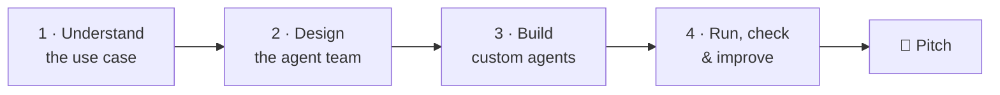

# 🤖 From Use Case to Agent Team

A 60-minute hands-on lab for GitHub Copilot: pick one of two real-world sales use cases, run an **architecture session** with Copilot,
design a team of **specialized agents** — and build, run and improve it locally in VS Code.

## 👉 [Open the lab](https://moaw.dev/workshop/gh:LaetitiaMa1410/ghcp-agent-team-lab/main/docs/)

| | |
| --- | --- |
| **Duration** | 60 minutes, teams of 3–4 |
| **Level** | Step-by-step with copy-paste prompts and checkpoints — plus 🚀 bonus challenges (orchestrator, skill, hook) for fast teams |
| **You need** | VS Code, GitHub Copilot, this repository |
| **You don't need** | Deployments, API keys, internet research, GitHub issues or pull requests |

## 🎯 Two use cases — pick one

Both are set at the fictional carrier **Contoso Wholesale**.

| | 🎯 [Lead generation](lead-generation/MISSION.md) | 🤝 [Partner cockpit](partner-cockpit/MISSION.md) |
| --- | --- | --- |
| **Mission** | Tell Sabine whom to meet at a conference, which product to pitch, and why | Prepare Jonas's cockpit for meeting 2 with a municipal utility that wants to offer fiber |
| **Data** | Participant lists in 3 formats, company profiles, CRM extract | Lead file, town & council data, network coverage, products, business case |
| **Agent pattern** | Pipeline | Parallel perspectives → opposing scenarios → synthesis |



## 🚦 Start here

```bash
git clone https://github.com/LaetitiaMa1410/ghcp-agent-team-lab.git
cd ghcp-agent-team-lab
code lead-generation     # or: code partner-cockpit
```

Then open the [lab](https://moaw.dev/workshop/gh:LaetitiaMa1410/ghcp-agent-team-lab/main/docs/) and follow the steps.

## 🗂️ Repository tour

```text
ghcp-agent-team-lab/
|-- lead-generation/     use case A — open this folder in VS Code
|   |-- MISSION.md       the use case — start here
|   |-- data/            fictional input data (read-only)
|   |-- out/             your agents write their results here
|   `-- solutions/       reference architecture, agents, bonus skill & hook, sample output
|-- partner-cockpit/     use case B — same structure
|-- docs/workshop.md     the lab (rendered on moaw.dev)
`-- facilitator/         notes for trainers
```

> All companies, people and data in this repository are fictional.
