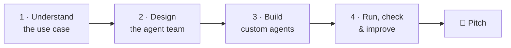

# 🤖 From Use Case to Agent Team

A 60-minute hands-on lab for GitHub Copilot: take a real-world use case, run an **architecture session** with Copilot,
design a team of **specialized agents** — and build, run and improve it locally in VS Code.

## 👉 [Open the lab](https://moaw.dev/workshop/gh:LaetitiaMa1410/ghcp-agent-team-lab/main/docs/)

| | |
| --- | --- |
| **Duration** | 60 minutes, teams of 3–4 |
| **Level** | Three paths: 🟢 Guided · 🔵 Standard · 🟣 Expert |
| **You need** | VS Code, GitHub Copilot, this repository |
| **You don't need** | Deployments, API keys, internet research, GitHub issues or pull requests |

## 🎯 The mission

Sabine, a Key Account Manager at the fictional carrier **Contoso Wholesale**, has 6 meeting slots at a conference.
Participant lists come from three sources in three formats, company names are inconsistent, and nobody knows who is worth talking to.

**Build a team of Copilot agents that tells her whom to meet, which product to pitch, and why.** → [`MISSION.md`](MISSION.md)



## 🚦 Start here

```bash
git clone https://github.com/LaetitiaMa1410/ghcp-agent-team-lab.git
cd ghcp-agent-team-lab
code .
```

Then open the [lab](https://moaw.dev/workshop/gh:LaetitiaMa1410/ghcp-agent-team-lab/main/docs/) and follow the steps.

## 🗂️ Repository tour

```text
ghcp-agent-team-lab/
|-- MISSION.md          the use case — start here
|-- data/               fictional input data (read-only)
|-- out/                your agents write their results here
|-- solutions/          reference architecture, agents and sample output
|-- docs/workshop.md    the lab (rendered on moaw.dev)
`-- facilitator/        notes for trainers
```

> All companies, people and data in this repository are fictional.
