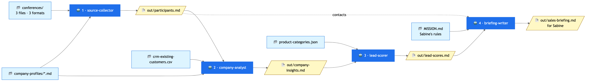

# From Use Case to Agent Team

<style>:root{--text-base-size:17px}html{font-size:var(--text-base-size)}.container{max-width:1200px!important}</style>

*Hands-on lab · 60 minutes · teams of 3–4*

You know the building blocks: prompting, context engineering, custom instructions, custom agents, skills.
Now you combine them on a **real-world use case** — and start like good architects do: **understand the problem before you build**.

| # | Task | Time | You end up with |
| --- | --- | --- | --- |
| 0 | Choose a use case & setup | 5 min | The use case folder open in VS Code, roles assigned |
| 1 | Architecture session | 20 min | `architecture.md` — diagram, handoffs, agent cards |
| 2 | Build the agent team | 15 min | `AGENTS.md` + `.github/agents/*.agent.md` |
| 3 | Run, check & improve | 12 min | The final result in `out/` |
| 4 | Pitch | 8 min | Your result, presented in 60 seconds |

<div class="info" data-title="Everything stays local">

> You only need **VS Code**, **GitHub Copilot** and the lab repository. No deployments, API keys, internet research,
> issues or pull requests. All companies, people and data are **fictional** and live in the repo.

</div>

## The company

**Contoso Wholesale** is a (fictional) carrier. It doesn't sell to consumers — it sells **network services to other companies**,
who use them to serve their own customers. Its sales teams spend a lot of time **collecting and combining information from many sources**
before they talk to a customer. That's exactly where a team of agents can help.

Your team picks **one** of two use cases. Both use the same lab steps — only the data and the result differ.

👉 **[Choose your use case](https://moaw.dev/workshop/gh:LaetitiaMa1410/ghcp-agent-team-lab/main/docs/?step=1)**

---

<style>:root{--text-base-size:17px}html{font-size:var(--text-base-size)}.container{max-width:1200px!important}</style>

# Choose your use case

Read both, decide as a team, then go to [setup](https://moaw.dev/workshop/gh:LaetitiaMa1410/ghcp-agent-team-lab/main/docs/?step=2).

| | 🎯 **A · Lead generation** | 🤝 **B · Partner cockpit** |
| --- | --- | --- |
| **User** | Sabine, Key Account Manager | Jonas, Partner Sales Manager |
| **Question** | *Whom should I meet at the conference — and why?* | *How do I win the next commitment from this partner?* |
| **Input** | Participant lists in 3 formats, company profiles, CRM extract | Lead file, meeting notes, town & council data, network coverage, products |
| **Output** | One-page sales briefing with 6 meetings | Two-page partner cockpit for meeting 2 |
| **Agent pattern** | **Pipeline** — one step after the other | **Perspectives** — parallel analysts, two opposing scenarios, one synthesis |
| **Main challenge** | Messy data: duplicates, spellings, gaps | Contradictions, politics, facts vs. opinions |
| **Folder** | `lead-generation/` | `partner-cockpit/` |

## 🎯 A · Lead generation

Contoso sells **IP transit, international voice, mobile & IoT wholesale and backbone capacity** to other telecom companies.
Sales is shifting from **farming** (growing existing customers) to **hunting** (winning new ones). Conferences are the
best hunting grounds — but preparing for them is painful: participant lists come from **different sources in different formats**,
company names are **spelled differently**, finding out what a company needs takes **manual research**, and nobody knows **whom** to talk to, or **why now**.

In two weeks **Sabine** attends **WholesaleCon Europe 2026**. She has **6 meeting slots**.

<div class="important" data-title="Mission A">

> **Design and build a team of specialized GitHub Copilot agents that tells Sabine whom to meet, which product to pitch, and why.**

</div>

**Sabine wants a one-page sales briefing** with 6 recommended meetings (person, role, company, product, *why now* with evidence,
one opening question), booth visits, and companies she can skip.
**Her rules:** new customers first · every recommendation **traceable** to the data · only **name, job title and company** of people · **decision makers** preferred.
Full brief: [`lead-generation/MISSION.md`](https://github.com/LaetitiaMa1410/ghcp-agent-team-lab/blob/main/lead-generation/MISSION.md).

## 🤝 B · Partner cockpit

Contoso sells **fiber wholesale access** to partners — internet providers and municipal utilities — who sell internet service
under **their own brand**. Winning a partner takes several meetings with very different people: a technical lead, a managing director,
a supervisory board chaired by the mayor. Before each meeting, the sales manager has to combine **facts, regional politics, technical feasibility,
business scenarios and the right materials** — from many sources.

**Stadtwerke Lindenau**, the utility of a mid-sized town, wants to offer fiber internet. Meeting 1 is done.
**Meeting 2 is on 3 December** — one week before the supervisory board meets.

<div class="important" data-title="Mission B">

> **Design and build a team of specialized GitHub Copilot agents that prepares Jonas's partner cockpit for meeting 2.**

</div>

**Jonas wants a two-page partner cockpit** with the situation, who decides, technical fit, a **bold** and a **safe** scenario with a recommendation,
the meeting 2 plan (goal, next commitment step, questions, materials) and open points.
**His rules:** label every statement as *fact*, *customer statement*, *assessment*, *hypothesis* or *open question* · no invented numbers ·
internal stays internal · politically neutral · name and role only.
Full brief: [`partner-cockpit/MISSION.md`](https://github.com/LaetitiaMa1410/ghcp-agent-team-lab/blob/main/partner-cockpit/MISSION.md).

<div class="tip" data-title="Easter eggs 🥚">

> Both data sets are small but realistic: they hide **gaps, contradictions and traps**. Every trap your agent team handles correctly
> earns a point in the pitch.

</div>

---

<style>:root{--text-base-size:17px}html{font-size:var(--text-base-size)}.container{max-width:1200px!important}</style>

# Setup

You need **VS Code** with **GitHub Copilot** (signed in, Chat view: `Ctrl+Alt+I` / `Cmd+Ctrl+I`). Every team member gets their own copy
and opens **only the folder of your use case** — that's your workspace for the whole lab:

```bash
git clone https://github.com/LaetitiaMa1410/ghcp-agent-team-lab.git
cd ghcp-agent-team-lab
code lead-generation     # use case A
code partner-cockpit     # use case B
```

No Git? On the [repository page](https://github.com/LaetitiaMa1410/ghcp-agent-team-lab) select **Code → Download ZIP**, unzip, and open the use case folder in VS Code (**File → Open Folder…**).
Confirm **Workspace Trust**, open the Chat view and check that you can switch between **Ask**, **Plan** and **Agent** in the agent picker.

```text
lead-generation/   or   partner-cockpit/
|-- MISSION.md        the use case — start here
|-- data/             all input data (read-only)
|-- out/              your agents write their results here
`-- solutions/        reference solution — no peeking before the checkpoints 🙈
```

<div class="warning" data-title="Open the use case folder, not the repository root">

> All prompts and paths in this lab (`MISSION.md`, `data/`, `.github/agents/`) are relative to the use case folder.
> VS Code only finds your custom agents in the `.github/agents/` folder of the opened workspace.

</div>

## Team roles

| Role | Job |
| --- | --- |
| 🧑‍✈️ **Driver** | Shares the screen in task 1 and types the prompts. |
| 💼 **Product owner** | Plays Sabine or Jonas. Answers Copilot's questions about the business — *you* decide, not the AI. |
| 🔍 **Critic** | Challenges every answer: *"Is that really in the data?"* |

Task 1 runs on the driver's screen; at the end the driver shares `architecture.md` (e.g. via team chat) and everyone saves it in their copy.
From task 2 on, everyone works on their own machine and you compare results as a team.

<div class="warning" data-title="Keep an eye on the clock">

> Every task ends with a **checkpoint**. Behind schedule? Use it and move on — a finished pipeline beats a perfect architecture without a result.

</div>

---

# Hands-on

## 1 · Architecture session

**⏱ 20 minutes · together on the driver's screen**

Before you write a single agent, you need to know **what problem you solve**, **what data you have** and
**which pieces of work exist**. Copilot is your architecture sparring partner — it reads, explains and proposes; **your team decides**.

### 1a · Understand the use case (5 min)

Select the **Ask** agent and send:

```text
#file:MISSION.md
You are a solution architect. Help our team understand this use case before we design anything.
Read the files in data/ (ignore the solutions/ folder).

Answer in max. 12 bullets:
- the business goal and the user
- each data source: format, content, and data quality issues you notice
- the expected output
- what makes this use case hard

Then ask us the 3 most important clarifying questions, one at a time, and wait for our answer.
```

💼 The **product owner** answers the questions using `MISSION.md` — and where it says nothing, *decides*.
This is **context engineering**: you build a shared understanding for the team *and* for Copilot before asking for a design.

### 1b · Break it down into components (5 min)

In the same chat:

```text
Describe the work from the raw data to the final result as a sequence of steps.
Mark which steps depend on each other and which could run in parallel.
For each step: input, output, and whether it needs judgement (LLM) or could be a fixed rule.

Then propose a team of 3 to 5 specialized agents. Each agent has exactly ONE responsibility.
Explain why you split it this way, and what would go wrong with one big agent.
Don't write any files yet.
```

🔍 **Critic**, challenge the proposal: Does an agent only pass data along (→ merge)? Does one do two different things (→ split)?
Which step **must** come first, and what can run **in parallel**? Where does **personal data** flow? Where could the AI **invent** something?

- 🎯 **A:** Where are **company spellings** matched? Where are **existing customers** filtered out?
- 🤝 **B:** Which **perspectives** does Jonas need (facts, technology, the partner's people …)? Would **two opposing scenario agents** beat one "balanced" one? Who separates **facts from rumours**?

Tell Copilot what you decided, e.g. *"Merge agents 3 and 4. Split the scenario agent into a bold and a safe one."*

### 1c · Write the architecture overview (5 min)

Switch to the **Agent** agent and send:

```text
Create architecture.md in the workspace root. Use the agents we agreed on. Keep it to about one page:

1. The use case in one sentence.
2. A Mermaid flowchart (left to right) with all data sources, the agents, and the handoff files in out/.
3. A handoff contract table: file | producer | consumer(s) | content and structure.
4. Agent cards as a table: agent | responsibility | reads | writes | tools | done when.
   Tools follow least privilege: only 'read', 'search', 'edit'.
5. Shared guardrails that apply to every agent.
```

Read `architecture.md` as a team. (No Mermaid preview? No problem — agents read the text, not the picture.)

### 1d · Let a critic review the design (5 min)

Open a **new chat** (fresh context = unbiased reviewer), select **Ask** and send:

```text
#file:architecture.md #file:MISSION.md
Act as a critical senior architect reviewing this design. Find:
- the 3 biggest risks (think: invented facts or numbers, personal data in the output, contradicting sources)
- missing or unclear handoffs between agents
- agents that are too big or unnecessary
Max. 8 bullets, most important first.
```

Pick the 2–3 findings that matter most and let your **Agent** chat update `architecture.md`. Then the driver shares it with the team.

<div class="info" data-title="✅ Checkpoint 1">

> **You should have:** `architecture.md` with diagram, handoff contracts, agent cards and shared guardrails.
> Compare with the [reference architecture](https://moaw.dev/workshop/gh:LaetitiaMa1410/ghcp-agent-team-lab/main/docs/?step=4#reference-solutions) — can you explain *why* yours is different?
>
> **Behind schedule?** `cp solutions/architecture.md architecture.md` (PowerShell: `Copy-Item solutions/architecture.md architecture.md`)

</div>

## 2 · Build the agent team

**⏱ 15 minutes · everyone on their own machine**

Your architecture is the spec. Now it becomes **configuration**: shared rules go into `AGENTS.md`, role-specific
instructions into one `.agent.md` file per agent. Each agent gets a **small, focused context** — so you can test, fix and re-run one without touching the others.

### 2a · Shared guardrails in `AGENTS.md` (3 min)

**Agent**, new chat:

```text
#file:architecture.md
Create AGENTS.md in the workspace root. It contains ONLY the shared guardrails and conventions
that apply to every agent — nothing role-specific. Max. 15 lines, concrete and checkable.
```

Make sure it covers: **no internet**, **`data/` is read-only**, **write only to `out/`**, **no e-mail addresses or phone numbers in outputs**,
**every claim backed by a source file**, **say "unknown" instead of guessing**. 🤝 **B** also needs: **statement labels**, **no invented numbers**,
**internal stays internal**, **politically neutral**. Add what's missing yourself.

### 2b · Generate the agents (4 min)

Same chat:

```text
For every agent card in #file:architecture.md create .github/agents/<agent-name>.agent.md.

Frontmatter:
- name
- description: what the agent does and when to use it (one sentence)
- tools: only what it needs, from 'read', 'search', 'edit'

Body:
- the role in one sentence
- inputs: exact file paths
- steps
- output: the exact file in out/ and its structure, matching the handoff contract
- rules, including what it must NOT do because another agent does it

Don't repeat the guardrails from AGENTS.md.
```

Your agents should now appear in the agent picker. Not there? Check **Chat: Open Customizations → Agents** for frontmatter errors.

### 2c · Own one agent (8 min)

**Each person owns one agent** and reviews it:

| ✔ | Check |
| --- | --- |
| ☐ | **One** responsibility — nothing that belongs to another agent |
| ☐ | Inputs and outputs are **exact paths**; the output is exactly what the **next agent** expects |
| ☐ | It says what to do when data is **missing or ambiguous** |
| ☐ | **Least privilege** tools — does it really need `edit`? |
| ☐ | It knows when it is **done** |

Improve it by hand or with Copilot (*"Make the output section of #file:.github/agents/&lt;your-agent&gt;.agent.md
match the handoff contract in #file:architecture.md"*) and share your changes so everyone has the same agents.

<div class="info" data-title="✅ Checkpoint 2">

> **You should have:** `AGENTS.md` and one `.agent.md` per agent, all visible in the agent picker. **Behind schedule?** Copy the reference agents:
>
> ```bash
> # macOS / Linux
> mkdir -p .github/agents && cp solutions/agents/*.agent.md .github/agents/ && cp solutions/AGENTS.reference.md AGENTS.md
> ```
>
> ```powershell
> # Windows PowerShell
> New-Item -ItemType Directory -Force .github/agents | Out-Null; Copy-Item solutions/agents/*.agent.md .github/agents/; Copy-Item solutions/AGENTS.reference.md AGENTS.md
> ```

</div>

## 3 · Run, check & improve

**⏱ 12 minutes · everyone on their own machine**

### 3a · Run the pipeline (5 min)

Run your agents **in the order of your architecture**. For each agent: open a **new chat**, select the agent, send
`Run your step.` and **look at its output file in `out/`** before you start the next one.
That's your **human checkpoint** — an error in step 1 silently poisons everything after it.

🤝 **B:** Agents that don't depend on each other (e.g. the three analysts) can run **at the same time on different team members' machines** — share the files in `out/` afterwards.

### 3b · Quality checklist 🥚 (4 min)

Check the final result and the handoff files. Every "yes, handled correctly" is a point.

<details>
<summary>🎯 A · Lead generation — check <code>out/sales-briefing.md</code></summary>

| ✔ | Question |
| --- | --- |
| ☐ | Is every **person** listed only once, even if they appear in several sources? |
| ☐ | Did every **spelling** of a company end up at the right company? Are uncertain matches marked? |
| ☐ | What happened to companies **without a profile**? |
| ☐ | Are there **existing customers** among the 6 meetings? |
| ☐ | Is any company recommended that **doesn't buy wholesale** at all? |
| ☐ | Is any rating based on a **word taken out of context**? |
| ☐ | Are there **e-mail addresses** anywhere in `out/`? (Search for `@`) |
| ☐ | Can every **"why now"** be found in `data/`? |
| ☐ | Does every meeting have a **decision maker** where one exists? |

</details>

<details>
<summary>🤝 B · Partner cockpit — check <code>out/partner-cockpit.md</code></summary>

| ✔ | Question |
| --- | --- |
| ☐ | Which **launch date** is used — and is it the newest one? |
| ☐ | How many **households** does Lindenau have — from the data, or from someone's guess? |
| ☐ | Did news about a town with a **similar name** sneak in? |
| ☐ | Is every **district** counted correctly — funded, not yet funded, already covered by Contoso? |
| ☐ | Did a **rumour** make it into the meeting plan? |
| ☐ | Is the **council debate** described neutrally? |
| ☐ | Does the recommended **onboarding level** fit the partner's IT and the reference stories? Does the bold scenario ignore that? |
| ☐ | Is the partner's **service gap** spotted and answered with a product? |
| ☐ | Are **prices and internal materials** marked internal, and are only releasable materials planned for the meeting? |
| ☐ | Are there **e-mail addresses or phone numbers** anywhere in `out/`? Did anyone **invent** a competitor's offer? |

</details>

Compare with your teammates — **same agents, same data — same result?**

### 3c · Fix the agent, not the output (3 min)

Found a problem? **Don't edit `out/`** — fix the cause:

```text
#file:out/<final-result>.md
The result has this problem: <describe it>.
Look at the agent files in .github/agents/ and AGENTS.md.
Which agent caused it, and which instruction is missing or unclear?
Propose a minimal change to that agent file. Don't change any file in out/.
```

Apply the change and re-run **that agent and every agent after it**. Did the problem disappear?

<div class="info" data-title="✅ Checkpoint 3">

> **You should have:** the final result in `out/` and at least one improved agent.
> Example results: [A · `sample-output/`](https://github.com/LaetitiaMa1410/ghcp-agent-team-lab/tree/main/lead-generation/solutions/sample-output) ·
> [B · `sample-output/`](https://github.com/LaetitiaMa1410/ghcp-agent-team-lab/tree/main/partner-cockpit/solutions/sample-output).
> **Next:** [pitch](https://moaw.dev/workshop/gh:LaetitiaMa1410/ghcp-agent-team-lab/main/docs/?step=4).

</div>

---

<style>:root{--text-base-size:17px}html{font-size:var(--text-base-size)}.container{max-width:1200px!important}</style>

# Pitch & wrap-up

## 4 · Pitch

**⏱ 8 minutes · all teams together**

Each team gets **60 seconds**:

1. 🗺️ **Your architecture** — which agents, and why?
2. 🎯 **A:** your top 3 meetings for Sabine — who, what product, why now.<br/>🤝 **B:** your recommendation for Stadtwerke Lindenau and the next commitment step for meeting 2.
3. 🔧 **One fix** — what did your agent team get wrong, and which instruction fixed it?

Then **Sabine and Jonas vote**: whose result would they take into their meeting? 🥚 Easter egg points break a tie.

**Discussion:** Why did teams with the **same data** get **different** results? Which **human** decision changed the result?
How did the **pipeline** (A) and the **perspectives** pattern (B) differ? What would it take to run this **for real**?

## Reference solutions

**One** good solution per use case — not the only one. Compare the **reasoning**, not the names.

### 🎯 A · Lead generation — a pipeline



| Agent | Responsibility | Writes |
| --- | --- | --- |
| `source-collector` | Merges the 3 conference sources, matches company spellings to profiles, de-duplicates people | `out/participants.md` |
| `company-analyst` | Segment, current needs (with quotes) and existing-customer status per company | `out/company-insights.md` |
| `lead-scorer` | High / Medium / Low fit per company and product category, with quoted reasons | `out/lead-scores.md` |
| `briefing-writer` | Picks one decision maker per company and writes Sabine's briefing | `out/sales-briefing.md` |
| `lead-orchestrator` *(bonus)* | Runs the four agents as subagents and checks the result | – |

**Why:** matching comes first · existing customers are flagged before scoring · scoring is separate from writing.
Files: [`lead-generation/solutions/`](https://github.com/LaetitiaMa1410/ghcp-agent-team-lab/tree/main/lead-generation/solutions)

### 🤝 B · Partner cockpit — perspectives


| Agent | Responsibility | Writes |
| --- | --- | --- |
| `fact-analyst` | Partner, region, network per district, evidence ledger with labels, contradictions | `out/fact-sheet.md` |
| `tech-advisor` | Readiness, product fit per district type, onboarding level, risks | `out/tech-assessment.md` |
| `partner-voice` | Decision map, concerns, commitment ladder, tone | `out/partner-perspective.md` |
| `scenario-bold` | Ambitious but plausible scenario with 5-year numbers | `out/scenario-bold.md` |
| `scenario-safe` | Smallest viable entry with stop points | `out/scenario-safe.md` |
| `cockpit-writer` | Recommendation, meeting 2 plan, materials, open points | `out/partner-cockpit.md` |
| `concierge` *(bonus)* | Runs all agents as subagents and checks the result | – |

**Why:** three analysts in parallel, each with one perspective · two deliberately one-sided scenarios create productive tension · one writer resolves it.
Files: [`partner-cockpit/solutions/`](https://github.com/LaetitiaMa1410/ghcp-agent-team-lab/tree/main/partner-cockpit/solutions)

**In both:** files in `out/` are the handoffs — every intermediate result is visible · shared rules live in `AGENTS.md` ·
**least privilege** — workers can `read`, `search`, `edit`; the orchestrator can only delegate and read.

## Take it home

| What you did | Building block |
| --- | --- |
| Understand the use case with Copilot | Prompting, context engineering |
| Decompose into agents, handoff contracts, agent cards | Agent architecture, spec before code |
| Design review in a fresh chat | Context hygiene, AI-assisted review |
| `AGENTS.md` + `.agent.md` | Custom instructions, custom agents, least privilege |
| Check every handoff, fix the agent not the output | Human in the loop, *miss → diagnosis → fix* |

1. **Understand before you build.** 15 minutes of architecture with Copilot saves hours of re-prompting.
2. **Small agents, clear contracts.** One responsibility, one output file, explicit structure.
3. **Make the handoffs visible.** If you can't review it, you can't trust it.
4. **Fix causes, not symptoms.** Every agent mistake is a missing or unclear instruction.

<div class="tip" data-title="Do this next week">

> Take one recurring, multi-step task from your work and run step 1 of this lab on it — 20 minutes, time-boxed. The clarity is the win.

</div>
