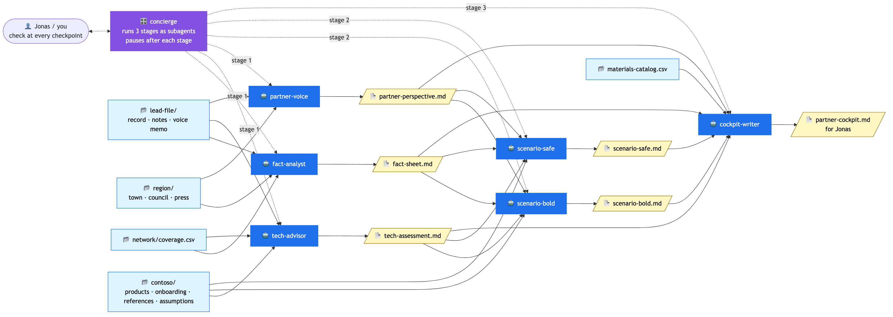

# From Use Case to Agent Team

<style>:root{--text-base-size:17px}html{font-size:var(--text-base-size)}.container{max-width:1200px!important}</style>

*Hands-on lab · teams of 3–4*

You know the building blocks: prompting, context engineering, custom instructions, custom agents, skills.
Now you combine them on a **real-world use case** — and start like good architects do: **understand the problem before you build**.

| # | Task | You end up with |
| --- | --- | --- |
| 0 | Choose a use case & setup | The use case folder open in VS Code, roles assigned |
| 1 | Architecture session | `design/` (data inventory, interview notes, requirements, decision record) and `architecture.md` |
| 2 | Build the agent team | `AGENTS.md`, specialized agents + an orchestrator in `.github/agents/` |
| 3 | Run, check & improve | The final result in `out/`, accepted by your stakeholder |
| 4 | Pitch & debrief | Your design and result, presented to everyone |

Most of your effort goes into the **architecture session** — on purpose. You'll interview a stakeholder, write requirements,
compare architecture options and have your design challenged, before you write a single agent.

<div class="info" data-title="Everything stays local">

> You only need **VS Code**, **GitHub Copilot** and the lab repository. No deployments, API keys, internet research,
> issues or pull requests. All companies, people and data are **fictional** and live in the repo.

</div>

## The company

**Contoso Wholesale** is a (fictional) carrier. It doesn't sell to consumers — it sells **network services to other companies**,
who use them to serve their own customers. Its sales teams spend a lot of time **collecting and combining information from many sources**
before they talk to a customer. That's exactly where a team of agents can help.

Your team picks **one** of two use cases. Both use the same lab steps — only the data and the result differ.

👉 **[Choose your use case](https://moaw.dev/workshop/gh:LaetitiaMa1410/ghcp-agent-team-lab/main/docs/?step=1)**

---

<style>:root{--text-base-size:17px}html{font-size:var(--text-base-size)}.container{max-width:1200px!important}</style>

# Choose your use case

Read both, decide as a team, then go to [setup](https://moaw.dev/workshop/gh:LaetitiaMa1410/ghcp-agent-team-lab/main/docs/?step=2).

| | 🎯 **A · Lead generation** | 🤝 **B · Partner cockpit** |
| --- | --- | --- |
| **User** | Sabine, Key Account Manager | Jonas, Partner Sales Manager |
| **Question** | *Whom should I meet at the conference — and why?* | *How do I win the next commitment from this partner?* |
| **Input** | Participant lists in 3 formats, company profiles, CRM extract | Lead file, meeting notes, town & council data, network coverage, products |
| **Output** | One-page sales briefing with 6 meetings | Two-page partner cockpit for meeting 2 |
| **Agent pattern** | **Pipeline** — one step after the other | **Perspectives** — parallel analysts, two opposing scenarios, one synthesis |
| **Main challenge** | Messy data: duplicates, spellings, gaps | Contradictions, politics, facts vs. opinions |
| **Folder** | `lead-generation/` | `partner-cockpit/` |

## 🎯 A · Lead generation

Contoso sells **IP transit, international voice, mobile & IoT wholesale and backbone capacity** to other telecom companies.
Sales is shifting from **farming** (growing existing customers) to **hunting** (winning new ones). Conferences are the
best hunting grounds — but preparing for them is painful: participant lists come from **different sources in different formats**,
company names are **spelled differently**, finding out what a company needs takes **manual research**, and nobody knows **whom** to talk to, or **why now**.

In two weeks **Sabine** attends **WholesaleCon Europe 2026**. She has **6 meeting slots**.

<div class="important" data-title="Mission A">

> **Design and build a team of specialized GitHub Copilot agents that tells Sabine whom to meet, which product to pitch, and why.**

</div>

**Sabine wants a one-page sales briefing** with 6 recommended meetings (person, role, company, product, *why now* with evidence,
one opening question), booth visits, and companies she can skip.
**Her rules:** new customers first · every recommendation **traceable** to the data · only **name, job title and company** of people · **decision makers** preferred.
Business brief: [`lead-generation/USE-CASE.md`](https://github.com/LaetitiaMa1410/ghcp-agent-team-lab/blob/main/lead-generation/USE-CASE.md) · deliverable spec: [`MISSION.md`](https://github.com/LaetitiaMa1410/ghcp-agent-team-lab/blob/main/lead-generation/MISSION.md).

## 🤝 B · Partner cockpit

Contoso sells **fiber wholesale access** to partners — internet providers and municipal utilities — who sell internet service
under **their own brand**. Winning a partner takes several meetings with very different people: a technical lead, a managing director,
a supervisory board chaired by the mayor. Before each meeting, the sales manager has to combine **facts, regional politics, technical feasibility,
business scenarios and the right materials** — from many sources.

**Stadtwerke Lindenau**, the utility of a mid-sized town, wants to offer fiber internet. Meeting 1 is done.
**Meeting 2 is on 3 December** — one week before the supervisory board meets.

<div class="important" data-title="Mission B">

> **Design and build a team of specialized GitHub Copilot agents that prepares Jonas's partner cockpit for meeting 2.**

</div>

**Jonas wants a two-page partner cockpit** with the situation, who decides, technical fit, a **bold** and a **safe** scenario with a recommendation,
the meeting 2 plan (goal, next commitment step, questions, materials) and open points.
**His rules:** label every statement as *fact*, *customer statement*, *assessment*, *hypothesis* or *open question* · no invented numbers ·
internal stays internal · politically neutral · name and role only.
Business brief: [`partner-cockpit/USE-CASE.md`](https://github.com/LaetitiaMa1410/ghcp-agent-team-lab/blob/main/partner-cockpit/USE-CASE.md) · deliverable spec: [`MISSION.md`](https://github.com/LaetitiaMa1410/ghcp-agent-team-lab/blob/main/partner-cockpit/MISSION.md).

<div class="tip" data-title="Easter eggs 🥚">

> Both data sets are small but realistic: they hide **gaps, contradictions and traps**. Every trap your agent team handles correctly
> earns a point in the pitch.

</div>

---

<style>:root{--text-base-size:17px}html{font-size:var(--text-base-size)}.container{max-width:1200px!important}</style>

# Setup

You need **VS Code** with **GitHub Copilot** (signed in, Chat view: `Ctrl+Alt+I` / `Cmd+Ctrl+I`). Every team member gets their own copy
and opens **only the folder of your use case** — that's your workspace for the whole lab:

```bash
git clone https://github.com/LaetitiaMa1410/ghcp-agent-team-lab.git
cd ghcp-agent-team-lab
code lead-generation     # use case A
code partner-cockpit     # use case B
```

No Git? On the [repository page](https://github.com/LaetitiaMa1410/ghcp-agent-team-lab) select **Code → Download ZIP**, unzip, and open the use case folder in VS Code (**File → Open Folder…**).
Confirm **Workspace Trust**, open the Chat view and check that you can switch between **Ask**, **Plan** and **Agent** in the agent picker.

```text
lead-generation/   or   partner-cockpit/
|-- USE-CASE.md       the business brief — start here
|-- MISSION.md        the deliverable spec: what the user wants and their rules
|-- data/             all input data (read-only)
|-- design/           you create it: data inventory, interview notes, requirements, decision record
|-- out/              your agents write their results here
|-- .github/agents/   sabine / jonas: the stakeholder you will interview
`-- solutions/        reference solution — no peeking before the checkpoints 🙈
```

<div class="warning" data-title="Open the use case folder, not the repository root">

> All prompts and paths in this lab (`USE-CASE.md`, `data/`, `design/`, `.github/agents/`) are relative to the use case folder.
> VS Code only finds your custom agents in the `.github/agents/` folder of the opened workspace.

</div>

## Team roles

| Role | Job |
| --- | --- |
| 🧑‍✈️ **Driver** | Shares the screen in task 1 and types the prompts. |
| 💼 **Interviewer** | Leads the stakeholder interview, owns the requirements and makes the business decisions — *you* decide, not the AI. |
| 🔍 **Critic** | Challenges every answer: *"Is that really in the data? Can we check that?"* |
| 📝 **Scribe** *(4th person)* | Notes decisions and open questions. |

Task 1 runs on the driver's screen; at the end the driver shares `design/` and `architecture.md` (e.g. via team chat) and everyone saves them in their copy.
From task 2 on, everyone works on their own machine and you compare results as a team.

<div class="warning" data-title="Keep an eye on the clock">

> Every task ends with a **checkpoint**. Behind schedule? Use it and move on — a finished pipeline beats a perfect architecture without a result.

</div>

---

# Hands-on

## 1 · Architecture session

**Together on the driver's screen**

Good agent teams aren't designed in a prompt — they're designed like any other software: **understand the problem, talk to the user,
write down what "good" means, compare options, decide, and let others challenge it**. Copilot is your sparring partner in every step;
**your team decides**. Everything you produce goes into a `design/` folder — it becomes the spec for your agents.

| Step | What you do | Result |
| --- | --- | --- |
| 1a | Understand the use case & the data | `design/data-inventory.md` |
| 1b | Interview the stakeholder | `design/interview-notes.md` |
| 1c | Requirements & acceptance criteria | `design/requirements.md` |
| 1d | Decompose: steps, dependencies, single agent or team? | decision in the chat |
| 1e | Compare options & decide | `design/adr-001-agent-topology.md` |
| 1f | Detailed design | `architecture.md` |
| 1g | Pre-mortem | improved `architecture.md` |
| 1h | Cross-team review | improved `architecture.md` |

### 1a · Understand the use case & the data

Select the **Agent** agent and send:

```text
#file:USE-CASE.md #file:MISSION.md
You are a solution architect. Help our team understand this use case before we design anything.
Read every file in data/. Ignore the solutions/ and .github/agents/ folders.

1. Summarize in max. 6 bullets: business goal, user, today's pain, what is in scope and out of scope.
2. Create design/data-inventory.md with a table:
   source | format | owner | content and key fields | personal data? | confidential? | quality issues
   Be specific about quality issues: quote the row or sentence.
3. Below the table: the 3-5 things in the data that would trick a naive solution, and what that means for the design.
```

🔍 **Critic:** open **two** of the data files yourself. Are the issues Copilot found really there? Did it miss one? Did it *invent* one?

### 1b · Interview the stakeholder

`USE-CASE.md` doesn't answer everything — just like in real life. **Sabine** (A) and **Jonas** (B) are waiting for your questions.

**Prepare.** In your 1a chat, send:

```text
We will interview the user now. Which 8 questions should we ask that USE-CASE.md and MISSION.md
don't answer yet? Cover: how they will use the result (when, where, on which device), what makes a result
good or useless, rules and no-gos, how to handle unknown or conflicting data, and what is out of scope.
```

Pick the 5–6 best questions as a team.

**Interview.** Open a **new chat**, select the **`sabine`** (A) or **`jonas`** (B) agent and interview them.
💼 The **interviewer** asks — one question at a time. Follow up with *"Why?"* and *"Can you give me an example?"*

Finish with: *"Thanks! Please summarize what you told us as a bullet list."* Create **`design/interview-notes.md`** and paste the summary.

<div class="warning" data-title="Don't peek">

> Don't open `.github/agents/sabine.agent.md` or `jonas.agent.md` — a real stakeholder doesn't come with a file either.
> The stakeholder only knows the business: ask about **needs**, not about agents.

</div>

### 1c · Requirements & acceptance criteria

**Agent**, new chat:

```text
#file:USE-CASE.md #file:MISSION.md #file:design/data-inventory.md #file:design/interview-notes.md
Create design/requirements.md:
1. 4-6 user stories ("As <user>, I want ..., so that ..."), each with 2-4 acceptance criteria
   that a reviewer can check against the final result with a clear yes or no.
2. Non-functional requirements as a table with IDs (data protection, traceability, readability,
   confidentiality, repeatability, ...).
3. Out of scope.
4. Open questions that neither the brief nor the interview answered.
Mark everything that came from the interview with 🗣. Don't add requirements that no source supports.
```

**Sign-off:** go back to the stakeholder chat and paste the user stories and acceptance criteria:
*"If our result meets all of these, would you use it? What's missing or wrong?"* — then update `requirements.md`.

🔍 **Critic:** is every acceptance criterion **checkable**? *"Good briefing"* is not. *"Exactly 6 meetings, only new customers"* is.

<div class="info" data-title="✅ Checkpoint 1 · Problem understood">

> **You should have:** `design/data-inventory.md`, `design/interview-notes.md` and a `design/requirements.md` your stakeholder signed off.
> **Behind schedule?** Copy the reference: `mkdir -p design && cp solutions/design/data-inventory.md solutions/design/requirements.md design/`
> (PowerShell: `New-Item -ItemType Directory -Force design | Out-Null; Copy-Item solutions/design/data-inventory.md, solutions/design/requirements.md design/`)

</div>

### 1d · Decompose: single agent or team?

**Ask**, new chat:

```text
#file:design/requirements.md #file:design/data-inventory.md
Describe the work from the raw data to the final result as a sequence of steps.
For each step: input, output, which step it depends on, whether it needs judgement (LLM) or could be a fixed rule,
and which user story it serves. Show which steps could run in parallel.

Then assess: one agent or a team of agents? Fill this table for our case:
criterion | one agent fits when ... | a team fits when ... | our case
Criteria: kind of task, input complexity, rules, perspectives that must be kept apart,
need to review intermediate results, repeatability.
```

| A team is worth it when… | One agent is enough when… |
| --- | --- |
| the work splits into **separable roles** | the task is recurring with **one clear output** |
| the input is **complex**, from many sources | the context is **small and retrievable** |
| **several perspectives** must be kept apart, not averaged | **one view** is enough |
| **intermediate results** need a human check | checking the end result is enough |
| a **synthesis** of different views is needed | there are **few conflicts** in the data |

🔍 **Critic:** Which step **must** come first? Where could the AI **invent** something? Where does **personal or internal data** flow?

- 🎯 **A:** Where are **company spellings** matched? Where are **existing customers** filtered out — before or after scoring?
- 🤝 **B:** Which **perspectives** does Jonas need? Would **two opposing scenario agents** beat one "balanced" one? Who separates **facts from rumours**?

### 1e · Compare options & decide

Same chat:

```text
Propose 3 clearly different architectures for this use case — for example one agent (with skills),
a pipeline of specialized agents, or parallel perspectives with a synthesis.
For each: the agents and their single responsibility, how they hand over work, pros, cons,
the main risks (invented facts, personal or internal data, contradicting sources) and the effort.
Recommend one, but don't write any files.
```

**Decide as a team** — each person names their favourite and one reason, then the interviewer decides.
Tell Copilot what you changed, e.g. *"Option 2, but merge agents 3 and 4"* or *"Split the scenario agent into a bold and a safe one."*

Switch to **Agent** in the same chat and send:

```text
Write our decision as design/adr-001-agent-topology.md (architecture decision record):
context, the one-agent-or-team assessment, the options table, the decision, consequences
(including which agent serves which user story) and when we should revisit the decision.
```

### 1f · Detailed design

**Agent**, new chat:

```text
#file:design/requirements.md #file:design/adr-001-agent-topology.md
Create architecture.md in the workspace root for the option we decided on. About 1-2 pages:

1. The use case in one sentence.
2. A Mermaid flowchart (left to right) with all data sources, the agents, the handoff files in out/,
   and an orchestrator that runs the agents.
3. A handoff contract table: file | producer | consumer(s) | content and structure (sections or columns).
4. Agent cards as a table: agent | responsibility | reads | writes | tools | done when | user stories.
   Tools follow least privilege: only 'read', 'search', 'edit'.
5. The orchestrator: in which order (or in parallel) it runs the agents as subagents, where it pauses
   (human checkpoints) and what the human checks at each. It only delegates and reads — tools 'agent', 'read', 'search'.
6. Shared guardrails that apply to every agent.
7. Traceability: every user story and non-functional requirement -> the agent(s) or guardrail that covers it.
   Flag any requirement that nothing covers.
```

Read `architecture.md` as a team. (No Mermaid preview? No problem — agents read the text, not the picture.) Fix every requirement flagged as uncovered.

### 1g · Pre-mortem

Open a **new chat** (fresh context = unbiased reviewer), **Ask**:

```text
#file:architecture.md #file:design/requirements.md #file:USE-CASE.md
Pre-mortem: imagine it's the day after the conference (A) / meeting 2 (B). The result of this agent team
was a disaster and the user stopped using it. Give the 5 most likely reasons — each tied to a specific agent,
handoff or missing guardrail in architecture.md — and the smallest design change that would have prevented it.
Most likely first. Max. 10 bullets.
```

Pick the 2–3 that matter most and let an **Agent** chat update `architecture.md`.

### 1h · Cross-team review

Pair up with another team. Each team presents its `architecture.md`, then the other team challenges it with these questions:

| ❓ | Question |
| --- | --- |
| 1 | Which **user story** does each agent serve? Is there an agent without one? |
| 2 | Where can a **wrong fact** enter — and which step or human catches it? |
| 3 | Where does **personal or internal data** flow, and where is it removed? |
| 4 | What does the human check at each **checkpoint**? |
| 5 | Which agent would you **merge or split** — and why? |

Take your best finding home and update `architecture.md`. Then the driver shares the `design/` folder and `architecture.md` with the team (e.g. via team chat) and everyone saves them in their copy.

<div class="info" data-title="✅ Checkpoint 2 · Design ready">

> **You should have:** `design/` with data inventory, interview notes, requirements and ADR, and an `architecture.md` with diagram,
> handoff contracts, agent cards, the orchestrator flow with checkpoints, shared guardrails and traceability.
> Compare with the [reference architecture](https://moaw.dev/workshop/gh:LaetitiaMa1410/ghcp-agent-team-lab/main/docs/?step=5#reference-solutions) — can you explain *why* yours is different?
>
> **Behind schedule?**
>
> ```bash
> # macOS / Linux
> mkdir -p design && cp solutions/design/*.md design/ && cp solutions/architecture.md architecture.md
> ```
>
> ```powershell
> # Windows PowerShell
> New-Item -ItemType Directory -Force design | Out-Null; Copy-Item solutions/design/*.md design/; Copy-Item solutions/architecture.md architecture.md
> ```

</div>

## 2 · Build the agent team

**Everyone on their own machine**

Your architecture is the spec. Now it becomes **configuration**: shared rules go into `AGENTS.md`, role-specific
instructions into one `.agent.md` file per agent. Each agent gets a **small, focused context** — so you can test, fix and re-run one without touching the others.
An **orchestrator** agent then runs the team for you — and stops after every step so you stay in control.

### 2a · Shared guardrails in `AGENTS.md`

**Agent**, new chat:

```text
#file:architecture.md #file:design/requirements.md
Create AGENTS.md in the workspace root. It contains ONLY the shared guardrails and conventions
that apply to every agent — nothing role-specific. Include the non-functional requirements.
Max. 15 lines, concrete and checkable.
```

Make sure it covers: **no internet**, **`data/` is read-only**, **write only to `out/`**, **no e-mail addresses or phone numbers in outputs**,
**every claim backed by a source file**, **say "unknown" instead of guessing**. 🤝 **B** also needs: **statement labels**, **no invented numbers**,
**internal stays internal**, **politically neutral**. Add what's missing yourself.

### 2b · Generate the specialized agents

Same chat:

```text
For every agent card in #file:architecture.md except the orchestrator, create .github/agents/<agent-name>.agent.md.

Frontmatter:
- name
- description: what the agent does and when to use it (one sentence)
- tools: only what it needs, from 'read', 'search', 'edit'

Body:
- the role in one sentence
- inputs: exact file paths
- steps
- output: the exact file in out/ and its structure, matching the handoff contract
- rules, including what it must NOT do because another agent does it
- the acceptance criteria from design/requirements.md that its output must meet

Don't repeat the guardrails from AGENTS.md.
```

Your agents should now appear in the agent picker. Not there? Check **Chat: Open Customizations → Agents** for frontmatter errors.

### 2c · Generate the orchestrator

The orchestrator calls your agents as **subagents** — each runs with its own, fresh context — and **pauses after every step**.
That pause is your **human checkpoint**: an error in step 1 would otherwise silently poison everything after it.

Same chat:

```text
#file:architecture.md
Create .github/agents/orchestrator.agent.md — a coordinator that runs our agents as subagents.

Frontmatter:
- name: orchestrator
- description: one sentence
- tools: ['agent', 'read', 'search']   (it delegates and reads, but never writes files itself)

Body:
- the steps from architecture.md: which agent(s) to call, the instruction to pass ("Run your step."),
  and the file(s) each must produce in out/. Agents that don't depend on each other run in parallel in one step.
- MOST IMPORTANT RULE, at the top: run exactly ONE step per turn, then end the turn, even if I ask
  for the full result. At the end of each turn: check that the files exist and are not empty, name 2-3
  things I should check in them, and end with "Reply continue for the next step, or describe a problem."
- on a problem: never fix files in out/ — name the agent that caused it and the missing instruction.
  When I reply "re-run", run that agent again and continue step by step from there.
- after the last step: a quality gate against the acceptance criteria in design/requirements.md and AGENTS.md —
  PASS or FAIL per criterion, with findings and which agent to fix.
```

💬 **Think about it:** Why does the orchestrator have no `edit` tool?

### 2d · Own one agent

**Each person owns one agent** (someone takes the orchestrator) and reviews it:

| ✔ | Check |
| --- | --- |
| ☐ | **One** responsibility — nothing that belongs to another agent |
| ☐ | Inputs and outputs are **exact paths**; the output is exactly what the **next agent** expects |
| ☐ | It says what to do when data is **missing or ambiguous** |
| ☐ | **Least privilege** tools — does it really need `edit`? |
| ☐ | It knows when it is **done** — and the **acceptance criteria** it serves |

Improve it by hand or with Copilot (*"Make the output section of #file:.github/agents/&lt;your-agent&gt;.agent.md
match the handoff contract in #file:architecture.md"*) and share your changes so everyone has the same agents.

Then do a **dry run on paper**: one person reads the orchestrator aloud, the others say what *their* agent reads and writes at each step.
Does every file an agent reads exist by then?

<div class="info" data-title="✅ Checkpoint 3">

> **You should have:** `AGENTS.md`, one `.agent.md` per agent plus the orchestrator, all visible in the agent picker. **Behind schedule?** Copy the reference agents (orchestrator: `lead-orchestrator` (A) / `concierge` (B)):
>
> ```bash
> # macOS / Linux
> mkdir -p .github/agents && cp solutions/agents/*.agent.md .github/agents/ && cp solutions/AGENTS.reference.md AGENTS.md
> ```
>
> ```powershell
> # Windows PowerShell
> New-Item -ItemType Directory -Force .github/agents | Out-Null; Copy-Item solutions/agents/*.agent.md .github/agents/; Copy-Item solutions/AGENTS.reference.md AGENTS.md
> ```

</div>

## 3 · Run, check & improve

**Everyone on their own machine**

### 3a · Run the team

New chat, select your **orchestrator** in the agent picker and send *"Prepare the result for Sabine."* (A) or *"Prepare the partner cockpit for meeting 2."* (B).
Watch the subagents appear in the chat.

At every **checkpoint** the orchestrator stops: **open the file(s) in `out/`** and look at what it points you to.
All good? Reply `continue`. Something wrong? Describe it — then fix the agent (3c).

🤝 Split the work: one person drives the orchestrator, the others review the handoff files at each checkpoint.

### 3b · Check against your requirements 🥚

First go through the **acceptance criteria** in `design/requirements.md` — met or not?
Then check the final result and the handoff files with the checklist. Every "yes, handled correctly" is a point.

<details>
<summary>🎯 A · Lead generation — check <code>out/sales-briefing.md</code></summary>

| ✔ | Question |
| --- | --- |
| ☐ | Is every **person** listed only once, even if they appear in several sources? |
| ☐ | Did every **spelling** of a company end up at the right company? Are uncertain matches marked? |
| ☐ | What happened to companies **without a profile**? |
| ☐ | Are there **existing customers** among the 6 meetings? |
| ☐ | Is any company recommended that **doesn't buy wholesale** at all? |
| ☐ | Is any rating based on a **word taken out of context**? |
| ☐ | Are there **e-mail addresses** anywhere in `out/`? (Search for `@`) |
| ☐ | Can every **"why now"** be found in `data/`? |
| ☐ | Does every meeting have a **decision maker** where one exists? |

</details>

<details>
<summary>🤝 B · Partner cockpit — check <code>out/partner-cockpit.md</code></summary>

| ✔ | Question |
| --- | --- |
| ☐ | Which **launch date** is used — and is it the newest one? |
| ☐ | How many **households** does Lindenau have — from the data, or from someone's guess? |
| ☐ | Did news about a town with a **similar name** sneak in? |
| ☐ | Is every **district** counted correctly — funded, not yet funded, already covered by Contoso? |
| ☐ | Did a **rumour** make it into the meeting plan? |
| ☐ | Is the **council debate** described neutrally? |
| ☐ | Does the recommended **onboarding level** fit the partner's IT and the reference stories? Does the bold scenario ignore that? |
| ☐ | Is the partner's **service gap** spotted and answered with a product? |
| ☐ | Are **prices and internal materials** marked internal, and are only releasable materials planned for the meeting? |
| ☐ | Are there **e-mail addresses or phone numbers** anywhere in `out/`? Did anyone **invent** a competitor's offer? |

</details>

Compare with your teammates — **same agents, same data — same result?**

**Stakeholder acceptance:** open your `sabine` / `jonas` chat from step 1b, paste the final result and ask:
*"Would you take this into your meeting? What would you change?"*

### 3c · Fix the agent, not the output

Found a problem? **Don't edit `out/`** — fix the cause:

```text
#file:out/<final-result>.md
The result has this problem: <describe it>.
Look at the agent files in .github/agents/ and AGENTS.md.
Which agent caused it, and which instruction is missing or unclear?
Propose a minimal change to that agent file. Don't change any file in out/.
```

Apply the change, then reply `re-run` in your orchestrator chat — it runs **that agent and every step after it** again, with checkpoints. Did the problem disappear?

<div class="info" data-title="✅ Checkpoint 4">

> **You should have:** the final result in `out/`, your stakeholder's feedback and at least one improved agent.
> Example results: [A · `sample-output/`](https://github.com/LaetitiaMa1410/ghcp-agent-team-lab/tree/main/lead-generation/solutions/sample-output) ·
> [B · `sample-output/`](https://github.com/LaetitiaMa1410/ghcp-agent-team-lab/tree/main/partner-cockpit/solutions/sample-output).
> **Next:** [pitch](https://moaw.dev/workshop/gh:LaetitiaMa1410/ghcp-agent-team-lab/main/docs/?step=5) — or, if you have time left, take on a [🚀 bonus challenge](https://moaw.dev/workshop/gh:LaetitiaMa1410/ghcp-agent-team-lab/main/docs/?step=4).

</div>

---

<style>:root{--text-base-size:17px}html{font-size:var(--text-base-size)}.container{max-width:1200px!important}</style>

# 🚀 Bonus challenges

**For teams that finished checkpoint 4 early.** Pick any challenge, in any order — each one extends the agent team you already have.
When the pitch starts, stop and pitch what you have.

| | Challenge | You learn |
| --- | --- | --- |
| 🧰 | **B1 · Skill** — turn the quality checklist into a reusable skill | When to use a skill instead of instructions or an agent |
| 🪝 | **B2 · Hook** — make `data/` *really* read-only | Instructions ask, hooks enforce |

## B1 · Skill

Your quality checklist from task 3b is useful again and again — for every run, and for every reviewer.
That's what **skills** are for: a folder with instructions (and optionally scripts or templates) that Copilot loads **only when needed**.

| Put it in… | when it is… |
| --- | --- |
| `AGENTS.md` | a rule that **always** applies to every agent |
| `.github/agents/*.agent.md` | a **role** with its own tools and responsibility |
| `.github/skills/*/SKILL.md` | a **reusable capability** that any agent (or you) can use **on demand** |

**Agent**, new chat — paste your checklist from task 3b at the end:

```text
Create a project skill in .github/skills/quality-check/SKILL.md.

Frontmatter:
- name: quality-check
- description: what it checks and when to use it (one sentence)

Body:
- read design/requirements.md, MISSION.md, AGENTS.md and all files in out/; verify claims against data/; never change any file
- one check per checklist item below, each with a clear "pass when" condition
- output: a table  # | check | PASS/FAIL | evidence , then an overall PASS or FAIL,
  and for every FAIL the agent in .github/agents/ that caused it and the missing instruction

Checklist:
<paste the checklist for your use case>
```

**Test it:** new chat, **Agent**, type `/quality-check` and send. Not there? Check **Chat: Open Customizations → Skills**.
Then add one line to your orchestrator's quality gate: *"Use the quality-check skill."*

## B2 · Hook

`AGENTS.md` says *"`data/` is read-only"*. But that's a **request** to the model — it usually follows it, but nothing *enforces* it.
A **hook** is a command that runs at a fixed point in the agent's workflow — for example **before every tool call** — and can **deny** it.
Deterministic, outside the model.

<div class="warning" data-title="Stretch challenge — check the prerequisites first">

> - **Node.js** installed (`node --version`) — the hook script is JavaScript.
> - Hooks are a **preview** feature and may be **disabled by your organization**. Use the **Copilot** session target (not *Local*) if your VS Code offers the choice.
> - Copilot loads hooks from `.github/hooks/` at the **root of the Git repository**. You opened a subfolder, so run `git init` once in your use case folder.
> - The folder must be **trusted** (Workspace Trust).

</div>

**Agent**, new chat:

```text
Create a Copilot hook that makes data/ read-only:

1. .github/hooks/protect-data.json
   { "version": 1, "hooks": { "preToolUse": [ { "type": "command",
     "command": "node .github/hooks/protect-data.cjs", "timeoutSec": 10 } ] } }

2. .github/hooks/protect-data.cjs
   - read the event JSON from stdin; fields: cwd, toolName, toolArgs (object or JSON string)
   - if the tool changes files (edit, create, apply_patch, ...) and a target path is inside data/,
     print {"permissionDecision":"deny","permissionDecisionReason":"data/ is read-only. Write to out/ instead."}
   - otherwise print {}
```

**Test it** — send a fake "edit a file in `data/`" event to your hook script, exactly as Copilot would:

```bash
echo '{"cwd":".","toolName":"edit","toolArgs":{"path":"data/test.md"}}' | node .github/hooks/protect-data.cjs
```

```powershell
'{"cwd":".","toolName":"edit","toolArgs":{"path":"data/test.md"}}' | node .github/hooks/protect-data.cjs
```

Expected: `{"permissionDecision":"deny",...}`. Change the path to `out/test.md` → expected: `{}`.

Now try it live: **new chat** (hooks load when a session starts), **Agent**: *"Try to create data/hook-test.md with the line TEST and tell me exactly what happened."*
Copilot refuses because of `AGENTS.md`? Great — your **instructions** work. The hook is the **safety net** for the day they don't.

💬 **Think about it:** Which of your other rules should be **enforced** by a hook instead of just being **asked for** in `AGENTS.md`?

<div class="info" data-title="✅ Reference solutions">

> Skill and hook: `solutions/bonus/`. To install them:
>
> ```bash
> # macOS / Linux
> mkdir -p .github/skills .github/hooks && cp -R solutions/bonus/skills/quality-check .github/skills/ && cp solutions/bonus/hooks/* .github/hooks/
> ```
>
> ```powershell
> # Windows PowerShell
> New-Item -ItemType Directory -Force .github/skills, .github/hooks | Out-Null; Copy-Item -Recurse solutions/bonus/skills/quality-check .github/skills/; Copy-Item solutions/bonus/hooks/* .github/hooks/
> ```
>
> **Next:** [pitch](https://moaw.dev/workshop/gh:LaetitiaMa1410/ghcp-agent-team-lab/main/docs/?step=5).

</div>

---

<style>:root{--text-base-size:17px}html{font-size:var(--text-base-size)}.container{max-width:1200px!important}</style>

# Pitch & wrap-up

## 4 · Pitch

**All teams together**

Each team presents briefly:

1. 🗺️ **Your architecture** — which agents, and the **one decision** from your ADR you'd defend?
2. 🎯 **A:** your top 3 meetings for Sabine — who, what product, why now.<br/>🤝 **B:** your recommendation for Stadtwerke Lindenau and the next commitment step for meeting 2.
3. 🔧 **One fix** — what did your agent team get wrong, and which instruction fixed it?
4. 🗣 **Your stakeholder** — what did Sabine or Jonas tell you that changed your design?

Then **Sabine and Jonas vote**: whose result would they take into their meeting? 🥚 Easter egg points break a tie.

**Discussion:** Why did teams with the **same data** get **different** results? Which **human** decision changed the result?
How did the **pipeline** (A) and the **perspectives** pattern (B) differ? What would it take to run this **for real**?

## Reference solutions

**One** good solution per use case — not the only one. Compare the **reasoning**, not the names.

### 🎯 A · Lead generation — a pipeline


| Agent | Responsibility | Writes |
| --- | --- | --- |
| `source-collector` | Merges the 3 conference sources, matches company spellings to profiles, de-duplicates people | `out/participants.md` |
| `company-analyst` | Segment, current needs (with quotes) and existing-customer status per company | `out/company-insights.md` |
| `lead-scorer` | High / Medium / Low fit per company and product category, with quoted reasons | `out/lead-scores.md` |
| `briefing-writer` | Picks one decision maker per company and writes Sabine's briefing | `out/sales-briefing.md` |
| `lead-orchestrator` | Runs the four agents as subagents, one step at a time with a checkpoint after each, then a quality gate | – |

**Why:** matching comes first · existing customers are flagged before scoring · scoring is separate from writing.
Files: [`lead-generation/solutions/`](https://github.com/LaetitiaMa1410/ghcp-agent-team-lab/tree/main/lead-generation/solutions)

### 🤝 B · Partner cockpit — perspectives



| Agent | Responsibility | Writes |
| --- | --- | --- |
| `fact-analyst` | Partner, region, network per district, evidence ledger with labels, contradictions | `out/fact-sheet.md` |
| `tech-advisor` | Readiness, product fit per district type, onboarding level, risks | `out/tech-assessment.md` |
| `partner-voice` | Decision map, concerns, commitment ladder, tone | `out/partner-perspective.md` |
| `scenario-bold` | Ambitious but plausible scenario with 5-year numbers | `out/scenario-bold.md` |
| `scenario-safe` | Smallest viable entry with stop points | `out/scenario-safe.md` |
| `cockpit-writer` | Recommendation, meeting 2 plan, materials, open points | `out/partner-cockpit.md` |
| `concierge` | Runs the three stages as subagents with a checkpoint after each, then a quality gate | – |

**Why:** three analysts in parallel, each with one perspective · two deliberately one-sided scenarios create productive tension · one writer resolves it.
Files: [`partner-cockpit/solutions/`](https://github.com/LaetitiaMa1410/ghcp-agent-team-lab/tree/main/partner-cockpit/solutions)

**In both:** files in `out/` are the handoffs — every intermediate result is visible · shared rules live in `AGENTS.md` ·
**least privilege** — workers can `read`, `search`, `edit`; the orchestrator can only delegate and read.

## Take it home

| What you did | Building block |
| --- | --- |
| Data inventory with Copilot | Prompting, context engineering |
| Stakeholder interview, requirements with acceptance criteria | Requirements engineering, spec before code |
| One agent or a team? Options and an ADR | Agent architecture, documented decisions |
| Handoff contracts, agent cards, traceability | Detailed design |
| Pre-mortem in a fresh chat, cross-team review | Context hygiene, AI-assisted and peer review |
| `AGENTS.md` + `.agent.md` | Custom instructions, custom agents, least privilege |
| Orchestrator with a checkpoint after every step | Subagents, delegation, human in the loop |
| Fix the agent, not the output | *Miss → diagnosis → fix* |
| 🚀 Bonus: skill, hook | Reusable skills, deterministic guardrails |

1. **Understand before you build.** An hour of architecture with Copilot saves days of re-prompting.
2. **Talk to the user.** The most important requirements weren't in the brief.
3. **Small agents, clear contracts.** One responsibility, one output file, explicit structure.
4. **Make the handoffs visible.** If you can't review it, you can't trust it.
5. **Fix causes, not symptoms.** Every agent mistake is a missing or unclear instruction.

<div class="tip" data-title="Do this next week">

> Take one recurring, multi-step task from your work and run steps 1a–1e of this lab on it — with your team, before you build anything. The clarity is the win.

</div>
