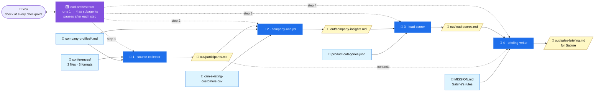

# Reference architecture — Lead generation agent team

> This is **one** possible solution. Your team's architecture may look different and still be good.
> Compare the *reasoning*, not the names.

## 1. Use case in one sentence

Turn messy conference data into a traceable sales briefing that tells Sabine whom to meet, what to pitch and why.

## 2. Components and data flow

**Execution order:** the `lead-orchestrator` runs `source-collector` → `company-analyst` → `lead-scorer` → `briefing-writer` as subagents,
**one step per turn**. After each step it stops at a **human checkpoint**: Sabine (or you) checks the new file and replies `continue` — or names a problem.
Each agent reads only the files it needs and writes exactly **one** file in `out/`.

## 3. Why these four agents?

| Decision | Reasoning |
| --- | --- |
| One agent per responsibility | Small, focused context per agent; each output can be reviewed on its own; one agent can be fixed and re-run without re-running everything. |
| Files in `out/` as handoffs | Every intermediate result is visible and reviewable by a human. No hidden state between agents. |
| Matching companies happens **first** | Every later step depends on knowing that "Nordwave" and "Nordwave Networks GmbH" are the same company. |
| CRM check in `company-analyst` | Existing customers must be flagged **before** scoring, so they don't take Sabine's 6 slots. |
| An orchestrator with checkpoints | One prompt starts the team, but a human checks every handoff before the next step builds on it. The orchestrator only delegates and reads — it can't "fix" outputs itself. |
| Scoring separate from writing | Scores and reasons can be checked before the briefing turns them into persuasive text. |
| Only `briefing-writer` picks contacts | Picking people needs both the participant list and the scores. It's also the only place where personal data reaches the final output, so it's the one place to enforce data minimization. |

### Rejected alternatives

- **One big agent:** quick to build, but its context grows with every file, and when it's wrong you can't see where.
- **A separate "contact-prioritizer":** possible, but for 21 participants it adds a handoff without much value. A good split for bigger data.
- **Web research agent:** valuable in real life, but out of scope here (no internet in this lab, and it needs its own guardrails).

## 4. Handoff contracts

| File | Producer | Consumer(s) | Content |
| --- | --- | --- | --- |
| `out/participants.md` | source-collector | company-analyst, briefing-writer | Table: person, job title, company (canonical name), profile file, sources, booth. Sections "Unmatched companies" and "Merge log". |
| `out/company-insights.md` | company-analyst | lead-scorer | Per company: segment, what they do (1 line), current needs with a quote from the profile, existing customer yes/no. |
| `out/lead-scores.md` | lead-scorer | briefing-writer | Table company × product category with High / Medium / Low / –, best-fit product, reason with a quote. |
| `out/sales-briefing.md` | briefing-writer | Sabine | 6 meetings, booth visits, not-a-priority list. |

## 5. Agent cards

| Agent | Responsibility | Reads | Writes | Tools | Done when |
| --- | --- | --- | --- | --- | --- |
| `source-collector` | Merge the 3 conference sources into one clean participant list; match company spellings to profiles | `data/conferences/**`, `data/company-profiles/` (names only) | `out/participants.md` | read, search, edit | Every source row is accounted for; every person appears once; unmatched companies listed |
| `company-analyst` | Describe each matched company and its current needs; flag existing customers | `out/participants.md`, `data/company-profiles/`, `data/crm-existing-customers.csv` | `out/company-insights.md` | read, search, edit | Every matched company has segment, needs and a quote |
| `lead-scorer` | Rate product fit per company and category, with reasons | `out/company-insights.md`, `data/product-categories.json` | `out/lead-scores.md` | read, search, edit | Every rating ≥ Medium has a quoted reason; no keyword-only matches |
| `briefing-writer` | Pick the best contact per company and write Sabine's briefing | `out/participants.md`, `out/lead-scores.md`, `MISSION.md` | `out/sales-briefing.md` | read, search, edit | 6 meetings, all rules from `MISSION.md` respected |
| `lead-orchestrator` | Run the four agents in order as subagents, pause for a human checkpoint after each step, run the quality gate | `out/*` | – | agent, read, search | All four files exist, every checkpoint confirmed, quality gate PASS |

## 6. Shared guardrails (→ `AGENTS.md`)

Rules that apply to **every** agent live in [`AGENTS.reference.md`](AGENTS.reference.md) (copy it to `AGENTS.md` in the workspace root to use it), not in each agent file:
no internet, `data/` is read-only, only write to `out/`, no e-mail addresses in outputs, every claim needs a source.
