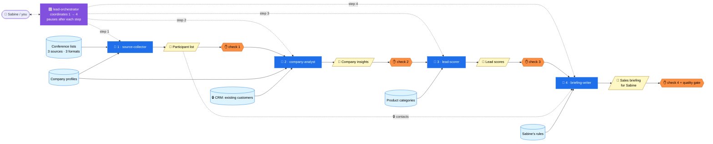

# Reference architecture — Lead generation agent team

> This is **one** possible solution. Your team's architecture may look different and still be good.
> Compare the *reasoning*, not the names.
>
> The architecture is **platform-neutral**: it describes the agent system, not the technology. The last section shows how it maps to
> GitHub Copilot custom agents (this lab) and to hosted agents in code.

## 1. Use case in one sentence

Turn messy conference data into a traceable sales briefing that tells Sabine whom to meet, what to pitch and why.

## 2. Decision and pattern

- **A team, not one agent:** four separable steps, messy input from several sources, and every intermediate result needs a human check.
- **Pattern: sequential pipeline** with a human checkpoint after every step — each step builds on the previous one.
- **Matching companies comes first:** every later step depends on knowing that "Nordwave" and "Nordwave Networks GmbH" are the same company.
- **Existing customers are flagged before scoring**, so they don't take Sabine's 6 slots.
- **Rejected:** one big agent (context grows with every source; when it's wrong you can't see where), parallel perspectives
  (the work is a chain, not several views), a separate contact-prioritizer (for 21 participants it adds a handoff without much value)
  and a web research agent (valuable in real life, but out of scope: no internet, and it needs its own guardrails).

## 3. Agent system and flow

## 4. Handoff contracts

| Artifact | Producer | Consumer(s) | Content and structure |
| --- | --- | --- | --- |
| Participant list | source-collector | company-analyst, briefing-writer | Table: person, job title, company (canonical name), matched profile, sources, booth. Sections "Unmatched companies" and "Merge log". |
| Company insights | company-analyst | lead-scorer | Per company: segment, what they do (1 line), current needs with a quote from the profile, existing customer yes/no. |
| Lead scores | lead-scorer | briefing-writer | Table company × product category with High / Medium / Low / –, best-fit product, reason with a quote. |
| Sales briefing | briefing-writer | Sabine | 6 meetings, booth visits, not-a-priority list. |

## 5. Agent cards

| Agent | Single responsibility | Reads | Produces | Capabilities | Done when |
| --- | --- | --- | --- | --- | --- |
| `source-collector` | Merge the 3 conference sources into one clean participant list; match company spellings to profiles | Conference lists, company profiles (names only) | Participant list | Read data, search, write own artifact | Every source row is accounted for; every person appears once; unmatched companies listed |
| `company-analyst` | Describe each matched company and its current needs; flag existing customers | Participant list, company profiles, CRM extract | Company insights | Read data, search, write own artifact | Every matched company has segment, needs and a quote |
| `lead-scorer` | Rate product fit per company and category, with reasons | Company insights, product categories | Lead scores | Read data, search, write own artifact | Every rating ≥ Medium has a quoted reason; no keyword-only matches |
| `briefing-writer` | Pick the best contact per company and write Sabine's briefing | Participant list, lead scores, Sabine's rules | Sales briefing | Read data, search, write own artifact | 6 meetings, all of Sabine's rules respected |

Only `briefing-writer` picks contacts: it is the one place where personal data reaches the final result, so it's the one place to enforce data minimization.

## 6. Orchestration flow

| Step | Agent | Human checkpoint — what to check |
| --- | --- | --- |
| 1 | source-collector | Is every person listed once? Are uncertain company matches marked? |
| 2 | company-analyst | Are existing customers flagged? Does every need have a quote? |
| 3 | lead-scorer | Is every rating backed by a quote, not a single keyword? |
| 4 | briefing-writer | 6 meetings, only new customers, no contact details — then the quality gate against the acceptance criteria |

The `lead-orchestrator` only coordinates: it starts one step, waits for the human, and never changes an artifact itself.
On a problem it names the agent that caused it; that agent and every step after it run again.

## 7. Shared guardrails

- **No internet.** The provided data is the only source of truth.
- **Source data is read-only.** Each agent produces exactly the artifact it is responsible for.
- **No invented facts.** Every statement about a company is backed by a short quote and its source; otherwise "unknown".
- **Data minimization.** Name, job title and company only — never e-mail addresses or other contact details.
- **Show uncertainty** instead of guessing; use the canonical company name from its profile.
- **Readable handoffs:** tables and short text, so a human can check them. Sabine reads the briefing on her phone.

## 8. Mapping to the implementation paths

| Concept | 🧪 GitHub Copilot custom agents (this lab) | 🏭 Hosted agents in code |
| --- | --- | --- |
| Data sources | Files in `data/` | APIs or connectors to conference tools, CRM, product catalog |
| Handoff artifacts | Markdown files in `out/` | Typed messages or documents in storage |
| Agents | `.github/agents/<agent>.agent.md` | One agent per card, e.g. Microsoft Agent Framework |
| Capabilities | Tools `read`, `search`, `edit` | Tools / functions with scoped permissions per agent |
| Orchestrator | `lead-orchestrator.agent.md`, runs the agents as subagents | Workflow that calls the agents |
| Human checkpoint | End of a chat turn, reply `continue` | Approval step in an app or Teams |
| Shared guardrails | `AGENTS.md` ([reference](AGENTS.reference.md)) | System prompts, policies, content safety, evaluations |
