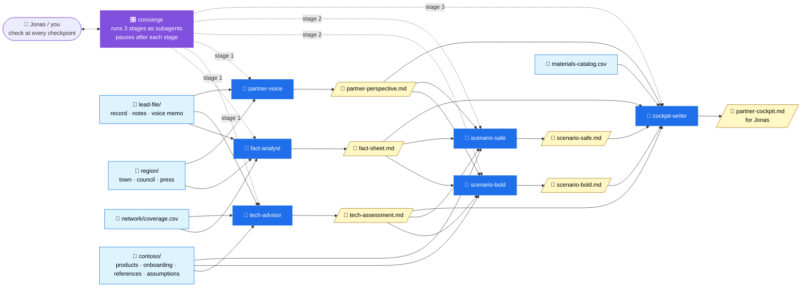

# Reference architecture — Partner cockpit agent team

> This is **one** possible solution. Your team's architecture may look different and still be good.
> Compare the *reasoning*, not the names.

## 1. Use case in one sentence

Turn scattered lead, regional, network and product information into a 2-page cockpit that helps Jonas win the next commitment from Stadtwerke Lindenau.

## 2. Components and data flow

**Execution order:** the `concierge` is Jonas's front door. It runs three stages as subagents — analyse in parallel (`fact-analyst`, `tech-advisor`, `partner-voice`) → build scenarios (`scenario-bold`, `scenario-safe`) → synthesize (`cockpit-writer`) —
and stops after **each stage** at a **human checkpoint**: check the new files, reply `continue` — or name a problem.
All files are written to `out/`.

## 3. Why these six agents?

| Decision | Reasoning |
| --- | --- |
| **Perspectives, not process steps** | Unlike a pipeline, the value comes from different viewpoints on the same lead: facts, technology, the partner's people. Each agent keeps one perspective sharp. |
| Three analysis agents in parallel | They only read `data/` and don't depend on each other — faster, and each output can be checked on its own. |
| **Bold vs. safe** as two agents | One agent asked for "a balanced scenario" averages everything out. Two deliberately one-sided agents create productive tension; the cockpit writer resolves it. |
| Facts and region merged | For one lead in one town, region and stakeholder facts are small. Splitting them adds a handoff without much value. |
| A concierge with checkpoints | One prompt starts the team; parallel agents run in one stage. A human checks every stage before the next one builds on it. The concierge only delegates and reads. |
| Synthesis in one agent | Recommendation, meeting plan and materials all need the full picture. One writer keeps the cockpit consistent and short. |
| Labels everywhere | *Fact / customer statement / sales assessment / hypothesis / open question* is the backbone of trust — it is enforced in `AGENTS.md`, not repeated in every agent. |

### Rejected alternatives

- **One big agent:** it mixes facts with opinions and the reasoning becomes invisible.
- **One agent per persona from the original idea (12+ agents):** great for a real product, too many handoffs to build and review in this lab.
- **A separate materials agent:** materials selection is a small step that depends on the recommendation, so it lives in the cockpit writer.
- **A creative "provocation" agent:** valuable, but it needs a strong review step (bonus idea).

## 4. Handoff contracts

| File | Producer | Consumer(s) | Content |
| --- | --- | --- | --- |
| `out/fact-sheet.md` | fact-analyst | scenarios, cockpit-writer | Partner, region, network table per district with totals, evidence ledger with labels and confidence, contradictions |
| `out/tech-assessment.md` | tech-advisor | scenarios, cockpit-writer | Readiness (ready/gap/unknown), product fit per district type, onboarding path, top 3 risks |
| `out/partner-perspective.md` | partner-voice | scenarios, cockpit-writer | Decision map, concerns, commitment ladder (reached / next), tone |
| `out/scenario-bold.md` | scenario-bold | cockpit-writer | Scope, 5-year customers (ambitious curve), assumptions, conditions, risks, pitch ideas |
| `out/scenario-safe.md` | scenario-safe | cockpit-writer | Scope, 5-year customers (conservative curve), assumptions, prerequisites, stop points, questions |
| `out/partner-cockpit.md` | cockpit-writer | Jonas | The 6 sections required by `MISSION.md`, max. 2 pages, marked INTERNAL |

## 5. Agent cards

| Agent | Responsibility | Reads | Writes | Tools | Done when |
| --- | --- | --- | --- | --- | --- |
| `fact-analyst` | Reliable fact base: partner, region, network, evidence ledger | `data/lead-file/`, `data/region/`, `data/network/` | `out/fact-sheet.md` | read, search, edit | Every statement labelled and sourced; contradictions resolved |
| `tech-advisor` | Readiness, product fit, onboarding level | `data/lead-file/`, `data/network/`, `data/contoso/` | `out/tech-assessment.md` | read, search, edit | Every gap has evidence; one product per district type |
| `partner-voice` | Decision map, concerns, commitment ladder | `data/lead-file/`, `data/region/` | `out/partner-perspective.md` | read, search, edit | Next commitment step identified |
| `scenario-bold` | Ambitious but plausible scenario | `out/` analysis files, `data/contoso/` | `out/scenario-bold.md` | read, search, edit | 5-year table with formula; conditions explicit |
| `scenario-safe` | Smallest viable entry | `out/` analysis files, `data/contoso/` | `out/scenario-safe.md` | read, search, edit | 5-year table with formula; stop points explicit |
| `cockpit-writer` | Recommendation and meeting plan | all of `out/`, `materials-catalog.csv`, `MISSION.md` | `out/partner-cockpit.md` | read, search, edit | All 6 sections, ≤ 2 pages, rules respected |
| `concierge` | Run the three stages as subagents, pause for a human checkpoint after each stage, run the quality gate | `out/*` | – | agent, read, search | All files exist, every checkpoint confirmed, quality gate PASS |

## 6. Shared guardrails (→ `AGENTS.md`)

Rules that apply to **every** agent live in [`AGENTS.reference.md`](AGENTS.reference.md) (copy it to `AGENTS.md` in the workspace root to use it):
no internet, `data/` is read-only, label every statement, no invented numbers, newer beats older, internal stays internal, politically neutral, no contact details.
