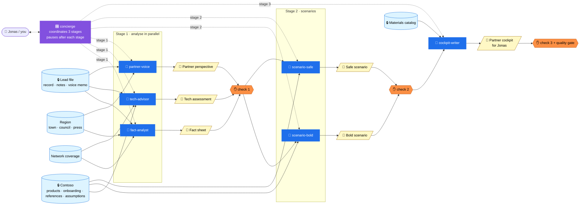

# Reference architecture — Partner cockpit agent team

> This is **one** possible solution. Your team's architecture may look different and still be good.
> Compare the *reasoning*, not the names.
>
> The architecture is **platform-neutral**: it describes the agent system, not the technology. The last section shows how it maps to
> GitHub Copilot custom agents (this lab) and to hosted agents in code.

## 1. Use case in one sentence

Turn scattered lead, regional, network and product information into a 2-page cockpit that helps Jonas win the next commitment from Stadtwerke Lindenau.

## 2. Decision and pattern

- **A team, not one agent:** several perspectives must be kept apart, the input comes from many sources, and the result needs a synthesis.
- **Pattern: parallel perspectives with a synthesis**, in three stages — analyse in parallel → build scenarios → synthesize — with a human checkpoint after each stage.
- **Bold vs. safe as two agents:** one agent asked for "a balanced scenario" averages everything out. Two deliberately one-sided agents create productive tension; the cockpit writer resolves it.
- **Facts and region merged:** for one lead in one town they are small; splitting them adds a handoff without much value.
- **Rejected:** one big agent (mixes facts with opinions, reasoning becomes invisible), one agent per persona from the original idea
  (12+ agents: great for a real product, too many handoffs here), a separate materials agent (small step that depends on the recommendation)
  and a creative "provocation" agent (valuable, but needs a strong review step — bonus idea).

## 3. Agent system and flow

The cockpit writer reads all five stage-1 and stage-2 artifacts.

## 4. Handoff contracts

| Artifact | Producer | Consumer(s) | Content and structure |
| --- | --- | --- | --- |
| Fact sheet | fact-analyst | scenarios, cockpit-writer | Partner, region, network table per district with totals, evidence ledger with labels and confidence, contradictions |
| Tech assessment | tech-advisor | scenarios, cockpit-writer | Readiness (ready/gap/unknown), product fit per district type, onboarding path, top 3 risks |
| Partner perspective | partner-voice | scenarios, cockpit-writer | Decision map, concerns, commitment ladder (reached / next), tone |
| Bold scenario | scenario-bold | cockpit-writer | Scope, 5-year customers (ambitious curve), assumptions, conditions, risks, pitch ideas |
| Safe scenario | scenario-safe | cockpit-writer | Scope, 5-year customers (conservative curve), assumptions, prerequisites, stop points, questions |
| Partner cockpit | cockpit-writer | Jonas | The 6 sections Jonas asked for, max. 2 pages, marked INTERNAL |

## 5. Agent cards

| Agent | Single responsibility | Reads | Produces | Capabilities | Done when |
| --- | --- | --- | --- | --- | --- |
| `fact-analyst` | Reliable fact base: partner, region, network, evidence ledger | Lead file, region, network coverage | Fact sheet | Read data, search, write own artifact | Every statement labelled and sourced; contradictions resolved |
| `tech-advisor` | Readiness, product fit, onboarding level | Lead file, network coverage, Contoso information | Tech assessment | Read data, search, write own artifact | Every gap has evidence; one product per district type |
| `partner-voice` | Decision map, concerns, commitment ladder | Lead file, region | Partner perspective | Read data, search, write own artifact | Next commitment step identified |
| `scenario-bold` | Ambitious but plausible scenario | The three analysis artifacts, Contoso information | Bold scenario | Read data, search, write own artifact | 5-year table with formula; conditions explicit |
| `scenario-safe` | Smallest viable entry | The three analysis artifacts, Contoso information | Safe scenario | Read data, search, write own artifact | 5-year table with formula; stop points explicit |
| `cockpit-writer` | Recommendation and meeting plan | All five artifacts, materials catalog, Jonas's rules | Partner cockpit | Read data, search, write own artifact | All 6 sections, ≤ 2 pages, rules respected |

## 6. Orchestration flow

| Stage | Agents | Human checkpoint — what to check |
| --- | --- | --- |
| 1 · Analyse | fact-analyst, tech-advisor, partner-voice — in parallel | Newest launch date? Household and district numbers from the data? Rumours labelled? |
| 2 · Scenarios | scenario-bold, scenario-safe — in parallel | Are the two really different? Every number from the data or marked as an assumption? |
| 3 · Synthesize | cockpit-writer | 6 sections, ≤ 2 pages, internal marked, only releasable materials — then the quality gate against the acceptance criteria |

The `concierge` is Jonas's front door. It only coordinates: it starts one stage, waits for the human, and never changes an artifact itself.
On a problem it names the agent that caused it; that agent and every stage after it run again.

## 7. Shared guardrails

- **No internet.** The provided data is the only source of truth. Source data is read-only; each agent produces exactly its own artifact.
- **Label every statement** as Fact, Customer statement, Sales assessment, Hypothesis or Open question, and name the source.
- **No invented numbers.** Every number comes from the data or is marked as an assumption with its basis.
- **Newer beats older.** On contradictions use the newer source and mention the contradiction.
- **Internal stays internal.** Prices, discounts and internal materials are marked INTERNAL.
- **Politically neutral.** Report positions and votes; never judge parties or politicians.
- **People:** name and role only — never e-mail addresses or phone numbers.

## 8. Mapping to the implementation paths

| Concept | 🧪 GitHub Copilot custom agents (this lab) | 🏭 Hosted agents in code |
| --- | --- | --- |
| Data sources | Files in `data/` | APIs or connectors to CRM, regional data, network planning, product catalog |
| Handoff artifacts | Markdown files in `out/` | Typed messages or documents in storage |
| Agents | `.github/agents/<agent>.agent.md` | One agent per card, e.g. Microsoft Agent Framework |
| Capabilities | Tools `read`, `search`, `edit` | Tools / functions with scoped permissions per agent |
| Orchestrator | `concierge.agent.md`, runs the agents as subagents, parallel within a stage | Workflow with parallel branches (fan-out / fan-in) |
| Human checkpoint | End of a chat turn, reply `continue` | Approval step in an app or Teams |
| Shared guardrails | `AGENTS.md` ([reference](AGENTS.reference.md)) | System prompts, policies, content safety, evaluations |
